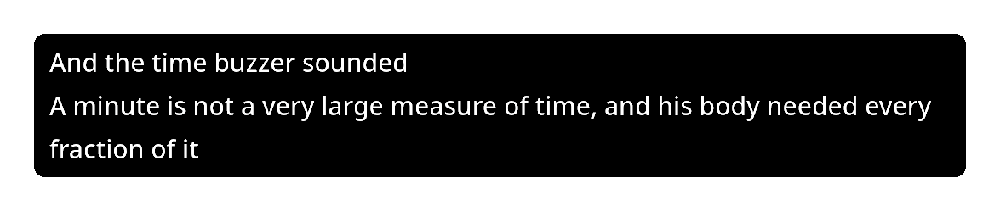

# NowCaption

Live captions for Linux. NowCaption shows what is being said in videos, calls,
streams and games, or into your microphone, in a small window that floats over
your desktop. It is made for people who are deaf or hard of hearing.



- **Private.** Everything runs on your computer, offline. No account, and audio never leaves it.
- **Accurate.** Punctuation and capital letters included. NowCaption's own speech model
  makes 2.7% word errors on clear speech, a third of upstream Live Captions' 8.1%, and in
  1.2.0 about a fifth fewer than before on meetings, calls, accents and noisy speech
  ([benchmark](benchmark/)).
- **Light.** Runs on the CPU as speech arrives. No GPU needed.

## Install

```sh
flatpak install --user --from https://techlm77.github.io/NowCaption/nowcaption.flatpakref
```

Updates then arrive with `flatpak update` or your software centre. Works on x86_64
and ARM64. You can also download a `.flatpak` file from the
[latest release](https://github.com/Techlm77/NowCaption/releases/latest) and run
`flatpak install --user NowCaption-*.flatpak`.

To uninstall: `flatpak uninstall io.github.Techlm77.NowCaption`.

**AppImage:** download `NowCaption-*-x86_64.AppImage` (or `aarch64`) from the
[latest release](https://github.com/Techlm77/NowCaption/releases/latest), then run
`chmod +x NowCaption-*.AppImage` and `./NowCaption-*.AppImage`. It runs on Ubuntu 22.04,
Debian 12 and anything newer: on systems older than 2024 it brings its own C library.
Gear Lever or AppImageUpdate can keep it up to date.

## Use

Captions start straight away from whatever your computer is playing. Drag them to
move, drag an edge to resize. **Right-click** for the menu:

- **Appearance:** text size, background and text colour
- **Position:** floating, or docked along an edge of the screen; reset the position and size
- **Transcript:** open the transcript, keep history, or clear this session
- **More options…:** what to listen to, desktop audio or your microphone, and how
  new words appear

On a touchscreen, touch and hold the captions for the menu, and right-click NowCaption in
your app launcher for **Open transcript**, **More options** and **Quit**.

**Transcript.** **Open transcript** shows everything captioned, in a window you can
scroll, select and copy from, and search with Ctrl+F. Earlier sessions are listed under
their date, and the current one updates as each line is finished. **Copy all** and
**Save** give the whole transcript; **Delete history** removes it.

**History.** NowCaption keeps each session's transcript for 7 days, then deletes it,
so it never fills up your disk. It stays on your computer, readable only by you, in
`~/.var/app/io.github.Techlm77.NowCaption/data/nowcaption/history` (Flatpak) or
`~/.local/share/nowcaption/history` (AppImage). Untick **Keep 7 days of history** in
the menu to stop keeping it. **Clear this session** also removes the current session
from the history.

**Text colour.** Captions are white by default. If another colour is easier for you to
read, pick one of the dots under **Text colour**: yellow, lime, cyan, orange, pink,
lavender, brown or red. The captions change as soon as you click, so you can compare
colours before closing the menu. NowCaption remembers your choice, like your text size,
background and position, every time it starts and after updates.

**New words.** New words fade in by default. Under **More options…** they can appear at
once instead, or arrive as pixels: **Pixel assemble** flies them together from left to
right, **Pixel dissolve** switches them on bit by bit, **Mosaic sharpen** brings them into
focus from big blocks, and **Pixel rain** drops them into place, each at a fast, normal or
slow speed. A sample caption in that window shows each one as you pick it, and **Apply**
uses your choices for the captions.

**Motion.** New lines glide up instead of jumping. The captions
fade in when NowCaption starts and out when it quits, and "Listening…" gently pulses
while NowCaption waits for speech. For no motion at all, turn animations off for your
desktop (on Plasma, set **Animation speed** to **Instant**; on GNOME, turn on **Reduce
Animation**) and NowCaption follows.

On KDE Plasma, Hyprland and Sway the captions float above all windows. On GNOME,
press Alt+Space on the window and choose **Always on Top**.

**Position.** On KDE Plasma, Hyprland and Sway, the little screens under **Position** in
the menu choose where the captions go. **Floating**, they stay wherever you drag them, over
any window. **Docked** at the top, bottom, left or right, they take that strip of the
screen like a panel, next to any panels already there, and maximised or snapped windows
make room for them, so nothing is covered. Drag the edge between the captions and your
windows to resize both together. Choosing another position slides the captions into their
edge and out of the new one, and your windows move along with them. On KDE Plasma 5.27
and 6, while a fullscreen game or video is open on their screen, docked captions float
above it and dock again when it closes; elsewhere, choose **Floating** for fullscreen apps.
Floating captions keep their bottom edge in place when you change the text size.

**KWin permission.** On KDE Plasma, the Flatpak may talk to KWin, so docked captions can
float over fullscreen apps. That lets it load a KWin script: NowCaption loads a small one
while the captions are docked, to learn when a fullscreen app opens on their screen. If
you'd rather not allow it, run
`flatpak override --user --no-talk-name=org.kde.KWin io.github.Techlm77.NowCaption`;
docked captions then stay docked under fullscreen apps.

**No captions?** Make sure sound plays through your default output device. After
switching to headphones, or after a problem, open **More options…** and press
**Restart**.

**First word missing?** When speech is hard to make out, such as strong accents or
unclear recordings, the first word after a pause is the one most often missed or misheard,
because the speech model has nothing yet to go on. 1.2.0's speech model misses far fewer of
them than before, but it still happens most there. Clear speech is rarely affected.

## Run from source

Needs GTK 4.12+ and libadwaita 1.5+ (Debian 13, Ubuntu 24.04, Fedora 40, Arch).

```sh
# Arch
sudo pacman -S python-gobject python-cairo gtk4 libadwaita gst-plugins-base gst-plugins-good gtk4-layer-shell
# Debian / Ubuntu
sudo apt install python3-gi python3-gi-cairo python3-venv gir1.2-gtk-4.0 gir1.2-adw-1 \
    gir1.2-gstreamer-1.0 gir1.2-gst-plugins-base-1.0 gstreamer1.0-plugins-good gstreamer1.0-pulseaudio
# Fedora
sudo dnf install python3-gobject python3-cairo gtk4 libadwaita gstreamer1-plugins-base gstreamer1-plugins-good

./tools/run-dev.sh        # downloads the models on first run
./tools/build-flatpak.sh  # or build the Flatpak
```

Tests: `PYTHONPATH=src .venv/bin/python tests/test_reliability.py` (fast, no models);
the other files in [`tests/`](tests/) say what they cover.

## Models

| Part | Model | License |
|---|---|---|
| Speech recognition | NowCaption's own, fine-tuned from NVIDIA's [FastConformer streaming](https://huggingface.co/nvidia/stt_en_fastconformer_hybrid_large_streaming_multi) | CC-BY-4.0 |
| Punctuation and capital letters | [Edge-Punct-Casing](https://github.com/frankyoujian/Edge-Punct-Casing) by frankyoujian | Apache-2.0 |

NowCaption's own code is MIT licensed. Everything else it ships with, and the speech its model
was trained on, is listed in [MODEL-LICENSES.md](MODEL-LICENSES.md). How speech model v3 was trained,
chosen and exported is in its [model card](MODEL-CARD-v3.md).
