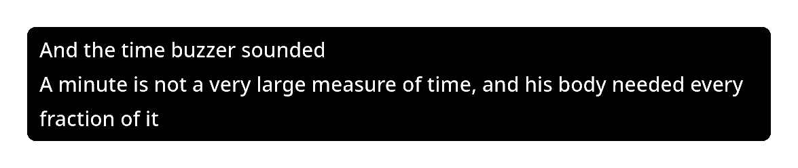

# NowCaption

Live captions for Linux. NowCaption shows what is being said in videos, calls,
streams and games, or into your microphone, in a small window that floats over
your desktop. It is made for people who are deaf or hard of hearing.



- **Private.** Everything runs on your computer, offline. No account, and audio never leaves it.
- **Accurate.** Punctuation and capital letters included. NowCaption's own speech model
  makes 2.7% word errors on clear speech, a third of upstream Live Captions' 8.1%, and
  13.0% on everyday speech from meetings, calls, podcasts, accents and noisy recordings
  ([benchmark](benchmark/)).
- **Light.** Runs on the CPU as speech arrives: since 1.2.2, about 7% of one CPU core for
  non-stop speech. No GPU needed.

## Install

```sh
flatpak install --user --from https://techlm77.github.io/NowCaption/nowcaption.flatpakref
```

Updates then arrive with `flatpak update` or your software centre. Works on x86_64
and ARM64. You can also download a `.flatpak` file from the
[latest release](https://github.com/Techlm77/NowCaption/releases/latest) and run
`flatpak install --user NowCaption-*.flatpak`.

To uninstall: `flatpak uninstall io.github.Techlm77.NowCaption`.

**AppImage:** download `NowCaption-*-x86_64.AppImage` (or `aarch64`) from the
[latest release](https://github.com/Techlm77/NowCaption/releases/latest), then run
`chmod +x NowCaption-*.AppImage` and `./NowCaption-*.AppImage`. It runs on Ubuntu 22.04,
Debian 12 and anything newer: on systems older than 2024 it brings its own C library.
Gear Lever or AppImageUpdate can keep it up to date.

## Tested on

Every system below was installed fresh in a virtual machine, fully updated, and then tested
in November 2026 with both the Flatpak and the AppImage: installing them as above, captioning
speech played on the desktop (90–94% of words right on the test clips everywhere), the launch
options, the windows, and docking. All passed. **Docks** means the captions can dock along an
edge like a panel (see **Position** below); **Floats** means they are an ordinary window that
your desktop places, because it has no way for apps to dock (GNOME, Cinnamon and every X11
session).

| Distro | Version | Desktop environment | Window manager | Session | Flatpak | AppImage | Before installing |
|---|---|---|---|---|---|---|---|
| Ubuntu | 26.04 LTS | GNOME 50 | Mutter 50 | Wayland | Floats | Floats | `sudo apt install flatpak`, then log out and back in |
| Ubuntu | 24.04 LTS | GNOME 46 | Mutter 46 | Wayland | Floats | Floats | `sudo apt install flatpak`, then log out and back in |
| Ubuntu | 22.04 LTS | GNOME 42 | Mutter 42 | Wayland and X11 | Floats | Floats | `sudo apt install flatpak`, then log out and back in |
| Debian | 13 | GNOME 48 | Mutter 48 | Wayland | Floats | Floats | `sudo apt install flatpak`, then log out and back in |
| Debian | 12 | GNOME 43 | Mutter 43 | Wayland | Floats | Floats | `sudo apt install flatpak`, then log out and back in |
| Fedora Workstation | 45 | GNOME 51 | Mutter 51 | Wayland | Floats | Floats | – |
| Fedora KDE | 45 | KDE Plasma 6.8 | KWin 6.8 | Wayland | Docks | Docks | – |
| Linux Mint | 22.3 | Cinnamon 6.6 | Muffin 6.6 | X11 | Floats | Floats | – |
| Zorin OS | 18.1 Core | GNOME 46 | Mutter 46 | Wayland | Floats | Floats | – |
| Pop!_OS | 24.04 LTS | COSMIC 1.11 | cosmic-comp | Wayland | Floats¹ | Docks | – |
| Arch Linux | rolling | KDE Plasma 6.8 | KWin 6.8 | Wayland | Docks | Docks | – |
| Arch Linux | rolling | GNOME 51 | Mutter 51 | Wayland | Floats | Floats | – |
| Arch Linux | rolling | – | Hyprland 0.57 | Wayland | Floats¹ | Docks | `sudo pacman -S flatpak`, then log out and back in |
| Arch Linux | rolling | – | Sway 1.12 | Wayland | Floats¹ | Docks | `sudo pacman -S flatpak`, then log out and back in |
| CachyOS | rolling | KDE Plasma 6.8 | KWin 6.8 | Wayland | Docks | Docks | `sudo pacman -S flatpak`, then log out and back in |
| EndeavourOS | rolling | KDE Plasma 6.8 | KWin 6.8 | Wayland | Docks | Docks | `sudo pacman -S flatpak`, then log out and back in |
| Manjaro | 26.1 | KDE Plasma 6.7 | KWin 6.7 | Wayland | Docks | Docks | – |
| openSUSE Tumbleweed | rolling | KDE Plasma 6.8 | KWin 6.8 | Wayland | Docks | Docks | – |
| Bazzite | 45 | KDE Plasma 6.8 | KWin 6.8 | Wayland | Docks | Docks | – |
| SteamOS (Desktop Mode) | 3.9 | KDE Plasma 6.7 | KWin 6.7 | X11 | Floats | Floats | – |
| NixOS | 26.05 | GNOME 50 | Mutter 50 | Wayland | Floats | Floats | Flatpak: `services.flatpak.enable = true;`. AppImage: `programs.appimage = { enable = true; binfmt = true; };`. Then `sudo nixos-rebuild switch` |

¹ COSMIC, Hyprland and Sway keep docking from sandboxed apps; the AppImage docks there, and
the Flatpak can too with one optional command (see **Hyprland, Sway and COSMIC** below).

## Use

Captions start straight away from whatever your computer is playing. Drag them to
move, drag an edge to resize. **Right-click** for the menu:

- **Appearance:** text size, background and text colour
- **Position:** floating, or docked along an edge of the screen; reset the position and size
- **Transcript:** open the transcript, keep history, or clear this session
- **Pause captions:** stop listening until you turn it off again
- **More options…:** what to listen to, desktop audio or your microphone; the caption
  font and how new words appear; how long transcripts are kept; word fixes; starting
  when you log in; keyboard shortcuts

On a touchscreen, touch and hold the captions for the menu, and right-click NowCaption in
your app launcher for **Open transcript**, **More options**, **Show or hide captions**,
**Pause or resume captions** and **Quit**.

**Transcript.** **Open transcript** shows everything captioned, in a window you can
scroll, select and copy from, and search with Ctrl+F. Earlier sessions are listed under
their date, and the current one updates as each line is finished. **Copy all** and
**Save** give the whole transcript; **Delete history** removes it.

**History.** NowCaption keeps each session's transcript for 7 days, then deletes it,
so it never fills up your disk. Under **More options…**, **Keep transcripts for** can
make that 1, 30 or 90 days, or keep them until you delete them. It stays on your computer,
readable only by you, in
`~/.var/app/io.github.Techlm77.NowCaption/data/nowcaption/history` (Flatpak) or
`~/.local/share/nowcaption/history` (AppImage). Untick **Keep 7 days of history** in
the menu to stop keeping it. **Clear this session** also removes the current session
from the history.

**Pause.** **Pause captions** in the menu stops listening altogether: nothing is
captured, captioned or kept until you turn it off. The words already heard stay in the
transcript.

**Word fixes.** The speech model sometimes mishears names it was never taught, such as
"Nvidia" written as "in video". Under **More options…**, **Word fixes** tells NowCaption
to show the right word whenever it writes the wrong one. Leave **When NowCaption writes**
empty to only set how a word is spelled, such as NVIDIA or KDE. A fix applies to
everything heard from then on, so pick words you would not otherwise say: a fix for
"in video" also changes "in video calls".

**Font.** Captions use your desktop's font. Under **More options…**, **Caption font**
picks any installed font, for example one made for easy reading; the sample caption
shows it before you press **Apply**.

**Start at login and shortcuts.** Under **More options…**, **Start when you log in**
starts NowCaption with your desktop. **Keyboard shortcuts** asks your desktop for two
keys that work in any app: Ctrl+Alt+C shows or hides the captions and Ctrl+Alt+P
pauses them (your desktop may let you pick others; KDE Plasma 6 and GNOME 48 or newer).
On any desktop you can also make your own shortcut that runs `nowcaption --toggle` or
`nowcaption --pause` (`flatpak run io.github.Techlm77.NowCaption --toggle` for the
Flatpak, or the AppImage's path followed by `--toggle`). Hidden captions keep captioning into the transcript; starting NowCaption again
also brings them back.

**Text colour.** Captions are white by default. If another colour is easier for you to
read, pick one of the dots under **Text colour**: yellow, lime, cyan, orange, pink,
lavender, brown or red. The captions change as soon as you click, so you can compare
colours before closing the menu. NowCaption remembers your choice, like your text size,
background and position, every time it starts and after updates.

**New words.** New words fade in by default. Under **More options…** they can appear at
once instead, or arrive as pixels: **Pixel assemble** flies them together from left to
right, **Pixel dissolve** switches them on bit by bit, **Mosaic sharpen** brings them into
focus from big blocks, and **Pixel rain** drops them into place, each at a fast, normal or
slow speed. A sample caption in that window shows each one as you pick it, and **Apply**
uses your choices for the captions.

**Motion.** New lines glide up instead of jumping. The captions
fade in when NowCaption starts and out when it quits, and "Listening…" gently pulses
while NowCaption waits for speech. For no motion at all, turn animations off for your
desktop (on Plasma, set **Animation speed** to **Instant**; on GNOME, turn on **Reduce
Animation**) and NowCaption follows.

Wherever the captions can dock (**Docks** in [Tested on](#tested-on)), they float above all
windows. On GNOME, press Alt+Space on the window and choose **Always on Top**.

**Position.** Wherever the captions can dock, the little screens under **Position** in
the menu choose where the captions go. **Floating**, they stay wherever you drag them, over
any window. **Docked** at the top, bottom, left or right, they take that strip of the
screen like a panel, next to any panels already there, and maximised or snapped windows
make room for them, so nothing is covered. Drag the edge between the captions and your
windows to resize both together. Choosing another position slides the captions into their
edge and out of the new one, and your windows move along with them. On KDE Plasma 5.27
and 6, while a fullscreen game or video is open on their screen, docked captions float
above it and dock again when it closes; elsewhere, choose **Floating** for fullscreen apps.
On KDE Plasma 6, a floating panel on the captions' edge stops floating while they're docked
against it, as it does when a window touches it, and floats again when they move away or
NowCaption quits. Plasma 5.27 has no way for apps to do that: there, turn off **Floating**
for that panel in Edit Mode, or dock the captions on another edge.
Floating captions keep their bottom edge in place when you change the text size.

**Hyprland, Sway and COSMIC.** The Flatpak can't dock there: these desktops keep docking from
sandboxed apps such as Flatpaks, as part of their security design, so it isn't a bug in
NowCaption. Its captions are an ordinary floating window, and the menu has no **Position**.
A way around it inside the sandbox was looked for, but every route hit the same wall. The
AppImage isn't sandboxed, and docks there out of the box. If you'd rather keep the Flatpak,
you can let it talk to the desktop directly, as the AppImage does, which also lets it see
the screen and type into other windows: run
`flatpak override --user --nosocket=wayland --filesystem=xdg-run/$WAYLAND_DISPLAY io.github.Techlm77.NowCaption`,
then log out and back in. `flatpak override --user --reset io.github.Techlm77.NowCaption`
undoes it, along with any other override you made for NowCaption, such as the KWin one below.

**KWin permission.** On KDE Plasma, the Flatpak may talk to KWin, so docked captions can
float over fullscreen apps. That lets it load a KWin script: NowCaption loads a small one
while the captions are docked, to learn when a fullscreen app opens on their screen. If
you'd rather not allow it, run
`flatpak override --user --no-talk-name=org.kde.KWin io.github.Techlm77.NowCaption`;
docked captions then stay docked under fullscreen apps.

**Plasma permission.** The Flatpak may also talk to Plasma, to turn a floating panel's
floating off while docked captions touch it (and back on after). If you'd rather not allow
it, run `flatpak override --user --no-talk-name=org.kde.plasmashell io.github.Techlm77.NowCaption`;
the panel then keeps floating next to docked captions.

**No captions?** Make sure sound plays through your default output device. After
switching to headphones, or after a problem, open **More options…** and press
**Restart**.

**First word missing?** When speech is hard to make out, such as strong accents or
unclear recordings, the first word after a pause is the one most often missed or misheard,
because the speech model has nothing yet to go on. Since 1.2.0 the speech model misses far
fewer of them than before, but it still happens most there. Clear speech is rarely affected.

## Run from source

Needs GTK 4.12+ and libadwaita 1.5+ (Debian 13, Ubuntu 24.04, Fedora 40, Arch).

```sh
# Arch
sudo pacman -S python-gobject python-cairo gtk4 libadwaita gst-plugins-base gst-plugins-good gtk4-layer-shell
# Debian / Ubuntu
sudo apt install python3-gi python3-gi-cairo python3-venv gir1.2-gtk-4.0 gir1.2-adw-1 \
    gir1.2-gstreamer-1.0 gir1.2-gst-plugins-base-1.0 gstreamer1.0-plugins-good gstreamer1.0-pulseaudio
# Fedora
sudo dnf install python3-gobject python3-cairo gtk4 libadwaita gstreamer1-plugins-base gstreamer1-plugins-good

./tools/run-dev.sh        # downloads the models on first run
./tools/build-flatpak.sh  # or build the Flatpak
```

Tests: `python3 tests/run.py` (fast, no models; `--gui` for the GTK tests under Xvfb);
[CONTRIBUTING.md](CONTRIBUTING.md#running-the-tests) says what is where in [`tests/`](tests/).

## Models

| Part | Model | License |
|---|---|---|
| Speech recognition | NowCaption's own, fine-tuned from NVIDIA's [FastConformer streaming](https://huggingface.co/nvidia/stt_en_fastconformer_hybrid_large_streaming_multi) | CC-BY-4.0 |
| Punctuation and capital letters | [Edge-Punct-Casing](https://github.com/frankyoujian/Edge-Punct-Casing) by frankyoujian | Apache-2.0 |

NowCaption's own code is MIT licensed. Everything else it ships with, and the speech its model
was trained on, is listed in [MODEL-LICENSES.md](MODEL-LICENSES.md). How speech model v4 was trained,
chosen and exported is in its [model card](MODEL-CARD-v4.md) (v3's, used by 1.2.0 and 1.2.1:
[MODEL-CARD-v3.md](MODEL-CARD-v3.md)).
