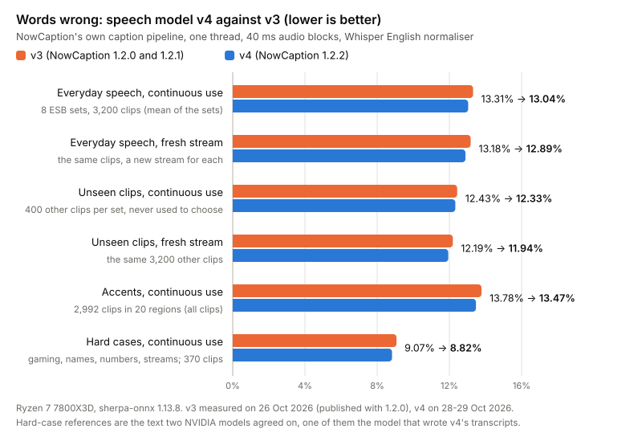
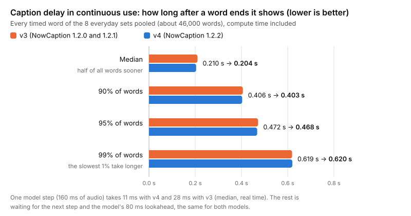
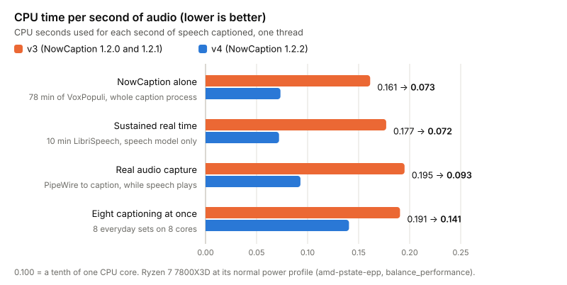
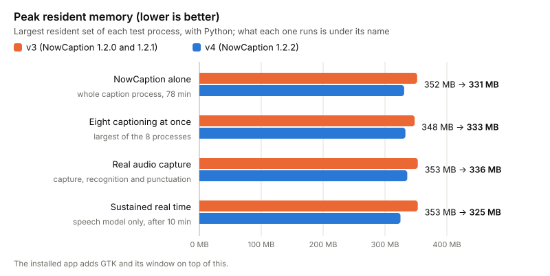
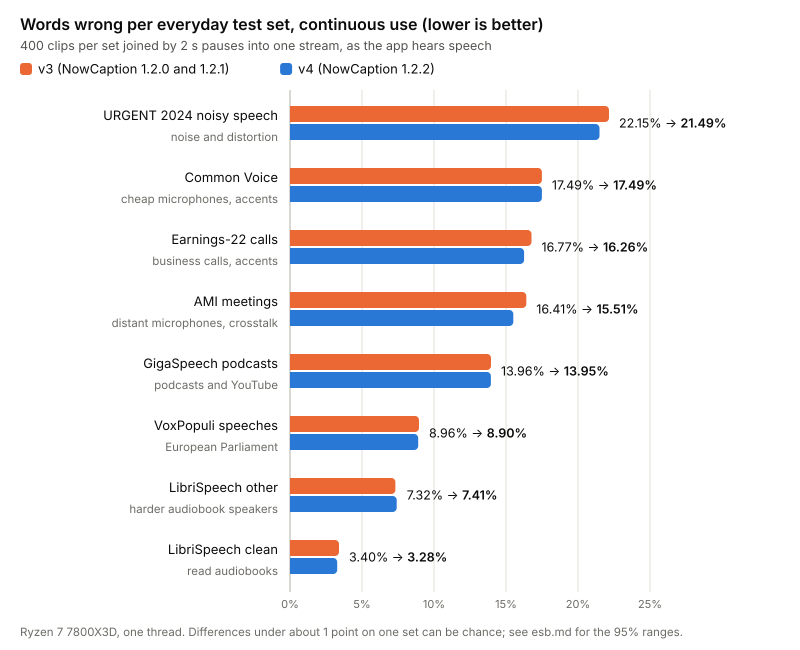

# Benchmark

How NowCaption 1.2.2 performs, and why it works the way it does. Everything was measured on one
machine, a Ryzen 7 7800X3D (Arch Linux, kernel 7.2, `amd-pstate-epp` with the balanced
performance preference, boost on), on the CPU through sherpa-onnx 1.13.8 (its own ONNX Runtime) with
one thread. 1.2.2 changes the speech model: NowCaption's own v4
(`nowcaption-fastconformer-en-80ms-cc-by-v4`) replaces v3. Where a table compares the two, v3's
numbers are the ones published for 1.2.0 (measured on 26 and 27 October 2026) and v4's were measured
on 28 and 29 October 2026 with the same scripts, settings and clips. v3 was not measured again.

There are four kinds of measurement:

- **Engine-only** (`bench.py`) feeds WAV audio straight into each speech engine, with a
  fresh stream for every clip. This compares engines.
- **Streaming** (`stream.py`) runs the app's own caption pipeline over a whole test set as one
  live stream, either continuously (as the app runs) or with a fresh stream for every clip. It
  is used for everyday speech, accents and hard cases, and for the engines other Linux apps use.
- **Continuous use** (`pipeline.py`) runs the caption pipeline on one stream of LibriSpeech
  clips, and can time each stage.
- **Real audio capture** (`e2e.py`) plays clips into a private PipeWire sink and captures
  them as the app does, through to the caption event.

The LibriSpeech sets are a fixed random sample of 3–15 s utterances (`get-data.py --set
test-clean / test-other`): 4 per speaker, from 40 test-clean speakers (160 clips, 3,151 words)
and 33 test-other speakers (132 clips, 2,369 words). test-other is the harder half. LibriSpeech
is read-aloud audiobook speech, so calls, games, music, overlapping voices and strong accents do
worse; the [everyday speech](#everyday-speech-streaming), [accent](#accents-streaming) and
[hard-case](#hard-cases-streaming) sets cover those.

## What's new in 1.2.2: speech model v4

v4 continues v3's training on the same 3,300 hours of CC0 and CC-BY speech, with new transcripts:
NVIDIA's Parakeet TDT 0.6B v2 transcribed every training clip again, because the machine labels most
of that speech came with often leave out the words at a clip's start and end. Its encoder is
exported in an equivalent but faster form that doesn't redo, at every step, work that doesn't depend
on the new audio ([how it was made](#how-the-model-was-chosen)). Through the app's own caption
pipeline, on the everyday test sets below unless noted:



| | v3 (1.2.0, 1.2.1) | **v4 (1.2.2)** | Change, with its 95% range |
|---|---|---|---|
| Words wrong, continuous use | 13.31% | **13.04%** | −0.27 (−0.47 to −0.07) points |
| Words wrong, fresh stream per clip | 13.18% | **12.89%** | −0.28 (−0.49 to −0.08) |
| The same, on 400 other clips per set never used to choose the model: continuous / fresh | 12.43% / 12.19% | **12.33% / 11.94%** | −0.10 (−0.30 to +0.11) / −0.26 (−0.47 to −0.06) |
| Accent test set (2,992 clips, 20 regions), continuous use: all clips / average of the regions | 13.78% / 12.04% | **13.47% / 11.53%** | average −0.51 (−0.85 to −0.11) |
| Hard cases (370 YouTube clips: gaming, names, numbers, live streams), continuous use: all clips / average of the 4 kinds | 9.07% / 9.11% | **8.82% / 8.86%** | average −0.26 (−0.59 to +0.07) |
| First two words after a pause, continuous use | 17.4% wrong | **16.9%** wrong | |
| Time until a word shows, continuous use: median / 90% / 95% / 99% | 0.210 / 0.406 / 0.472 / 0.619 s | **0.204 / 0.403 / 0.468** / 0.620 s | median −6 (−8 to −6) ms, 90% −4 (−6 to −3) ms, on the words both got right |
| Time until a word shows, fresh stream: median / 90% / 95% / 99% | 0.235 / 0.448 / 0.513 / 0.658 s | **0.226 / 0.435 / 0.501 / 0.646 s** | median −9 (−10 to −8) ms |
| CPU seconds per second of audio, NowCaption alone (78 min of speeches) | 0.161 | **0.073** | −55% |
| CPU fed in real time for 10 minutes, speech model only (share of one core) | 17.7% | **7.2%** | 7.0–7.2% in four runs |
| One model step (160 ms of audio), median / slowest 1%, same runs | 28.1 / 37.0 ms | **11.1 / 13.4 ms** | |
| Peak memory of the caption process, alone / eight at once | 352 / 348 MB | **331 / 333 MB** | |
| Download | 127 MB | **111 MB** | |
| Words printed over 60 noise clips / 40 instrumental music clips | 0 / 35 | **0 / 27** | the same two music clips |

A change counts as beyond chance when its whole 95% range lies on one side of zero: the clips of each
set are drawn again 2,000 times (the same draw for both models), and the range covers the middle 95%
of the changes (`compare.py`, as for 1.2.0). Delays are percentiles over every timed word of the eight
sets together, as in 1.2.0's tables; each set's percentile averaged over the sets gives 0.222 / 0.416 /
0.601 s for v3 and 0.215 / 0.411 / 0.604 s for v4 (median / 90% / 99%, continuous use). v4's 400 other
clips per set and hard cases were captioned on a second machine (Ryzen 9 7900X, the same sherpa-onnx,
model files and caption code); its transcripts are identical to the 7800X3D's (3,200 of 3,200 everyday
clips and 2,992 of 2,992 accent clips for v4, 12,592 clips for v3), so only their word errors are used.







Words wrong split into substituted, missed and extra words (Whisper normaliser, every set pooled):

| | Words | Substituted | Deleted (missed) | Inserted (extra) | Words wrong |
|---|---|---|---|---|---|
| 8 everyday sets, continuous, v3 | 54,033 | 3,590 (6.64%) | 2,234 (4.13%) | 904 (1.67%) | 12.45% |
| 8 everyday sets, continuous, v4 | 54,033 | 3,535 (6.54%) | 2,194 (4.06%) | 879 (1.63%) | 12.23% |
| 8 everyday sets, fresh stream, v3 | 54,033 | 3,537 (6.55%) | 2,263 (4.19%) | 858 (1.59%) | 12.32% |
| 8 everyday sets, fresh stream, v4 | 54,033 | 3,520 (6.51%) | 2,161 (4.00%) | 851 (1.57%) | 12.09% |
| 400 other clips per set, continuous, v3 | 54,279 | 3,368 (6.20%) | 2,205 (4.06%) | 728 (1.34%) | 11.61% |
| 400 other clips per set, continuous, v4 | 54,279 | 3,378 (6.22%) | 2,123 (3.91%) | 741 (1.37%) | 11.50% |
| 400 other clips per set, fresh, v3 | 54,279 | 3,360 (6.19%) | 2,141 (3.94%) | 730 (1.34%) | 11.48% |
| 400 other clips per set, fresh, v4 | 54,279 | 3,294 (6.07%) | 2,102 (3.87%) | 720 (1.33%) | 11.27% |
| Accents, continuous, v3 | 37,310 | 3,101 (8.31%) | 1,618 (4.34%) | 421 (1.13%) | 13.78% |
| Accents, continuous, v4 | 37,310 | 3,062 (8.21%) | 1,550 (4.15%) | 412 (1.10%) | 13.47% |
| Hard cases, continuous, v3 | 13,610 | 723 (5.31%) | 335 (2.46%) | 177 (1.30%) | 9.07% |
| Hard cases, continuous, v4 | 13,610 | 704 (5.17%) | 315 (2.31%) | 182 (1.34%) | 8.82% |

**Known limitations of v4.** All in continuous use unless noted:

- **Repeated words.** In 4 of 9,762 clips v4 printed a word four or more times in a row, more often
  than it was said: twice for a word said once ("sir sir sir sir sir sir sird" for the name Sigurd in
  LibriSpeech, "fall fall fall fall falls" in a Scottish accent clip) and twice one or two copies too
  many of a word said two or three times. v3 did it once ("yeah" 13 times for 3). With a fresh stream
  per clip neither model did it.
- **LibriSpeech test-other in `pipeline.py`** (132 clips, six pause patterns): 6.70% against 6.42%,
  worse in all six patterns. On the 400 ESB test-other clips it is 0.09 points worse (within chance), on
  400 others 0.19 better, and engine-only 6.7% against 6.9%.
- **Short sentences straight after a pause:** Common Voice's first two words after a pause show 17 ms
  later at the median (0.421 against 0.404 s), though fewer of them are wrong (18.0% against 19.0%).
- **Small changes within chance:** on the 400 other clips per set, AMI (+0.22) and Earnings-22 (+0.16)
  in continuous use; of the accent regions with at least 100 clips, England North (+0.43, 171 clips);
  live-stream talk in the hard cases (+0.21). The slowest 1% of words show 1 ms later.
- **Accents with a fresh stream** are about the same as with v3 (all clips 14.10% → 14.06%): as for v3,
  the accent gains come in continuous use, which is how the app runs.
- The **hard-case references** are the text two NVIDIA models agreed on, one of them the model that
  wrote v4's transcripts, which may favour v4 on that set.

**The goals for v4 and how it did.** They were set on 27 October 2026, before its training:

| Goal | v4 | Met? |
|---|---|---|
| About 13.0% or fewer words wrong on the eight sets | 13.04% continuous, 12.89% fresh (v3: 13.31%, 13.18%) | **Yes**, to within 0.04 points |
| Keep the faster encoder's CPU savings | 0.073 CPU seconds per second of audio alone (v3 0.161); 7.2% of a core in real time (v3 17.7%) | **Yes** |
| Delay and memory no worse than v3 | median 6 ms sooner, 90% 3 ms sooner, 99% 1 ms later; 21 MB less memory | **Yes**, apart from the 1 ms |
| Reliable across pauses, accents and hard recordings | first two words after a pause 16.9% wrong (v3 17.4%); accents −0.51 points on average, no region worse beyond chance; hard cases −0.26 (within chance); no new words over noise | **Yes**, with the limitations above |
| Confirmed on clips never used to choose it | 400 other clips per set: −0.10 continuous (within chance), −0.26 fresh (beyond chance) | **Partly**: lower, but only the fresh-stream change is beyond chance |

The 1.2.0 targets that v3 missed: CPU at most 15% of one 7800X3D core is now **met** (7.2%); at most
12.5% words wrong on the eight sets is still not met (13.04% / 12.89%; 12.33% / 11.94% on the other
clips); a median / 90% delay of at most 0.20 / 0.35 s in continuous use is still not met (0.204 /
0.403 s). The comparison of v3 with v2 for 1.2.0 is in [`results/1.2.0/`](results/1.2.0/) and this
page's history.

## Against Live Captions (engine-only)

| Engine | WER test-clean | WER test-other | Median lag | p90 lag | CPU | RAM |
|---|---|---|---|---|---|---|
| April English (upstream Live Captions) | 8.1% | 17.9% | 0.42 s | 0.52–0.54 s | 0.21 | 895 MB |
| NowCaption 1.2.0 (speech model v3) | 2.7% | 6.9% | 0.15–0.23 s | 0.31–0.39 s | 0.15 | 307–311 MB |
| **NowCaption 1.2.2 (speech model v4)** | **2.7%** | **6.7%** | **0.13–0.21 s** | **0.29–0.37 s** | **0.06** | **291–296 MB** |

NowCaption makes about two-thirds fewer errors than April, shows words sooner and uses less than a
third of the CPU and a third of the memory. Audio in 40 ms blocks as the app captures it, with 0.96 s
of silence before each new stream as the app primes it (`--warmup-ms 960`). On test-clean v4 makes 1
more error than v3 (85 against 84 in 3,151 words); on test-other 4 fewer (159 against 163).

April is measured as upstream Live Captions by abb128 ships it: abb128/april-asr at commit
`8b52f65` (the one Live Captions pins), built against ONNX Runtime 1.14.1 as in its Flatpak
manifest, with the `april-english-dev-01110_en.april` model it downloads (`build-april.sh`
reproduces this). It was fed 100 ms blocks; fed 100 ms blocks, NowCaption's 1.1.5 model had a
median lag of 0.31–0.37 s. Like every engine here it runs in sync mode on one thread; the Live
Captions app itself runs April in its asynchronous real-time mode.

## Everyday speech (streaming)

The [ESB](https://huggingface.co/datasets/hf-audio/esb-datasets-test-only-sorted) English test
sets, a fixed random sample of 400 clips from each (`get-esb.py`), joined into one session per set
with 2.0–2.1 s of silence between clips and fed in 40 ms blocks through the app's caption
pipeline on one thread (`stream.py`). Words are counted after the Whisper English normalizer, so
British and American spellings count as the same word. Words wrong:



| Test set | v3, continuous | **v4, continuous** | Change (95% range) | v3, fresh | **v4, fresh** | Change (95% range) |
|---|---|---|---|---|---|---|
| AMI (meetings) | 16.4% | **15.5%** | −0.90 (−1.74 to −0.06) | 16.5% | **15.2%** | −1.36 (−2.29 to −0.48) |
| Common Voice (cheap microphones, accents) | 17.5% | **17.5%** | +0.00 (−0.81 to +0.86) | 17.2% | **17.5%** | +0.36 (−0.48 to +1.20) |
| URGENT 2024 (noisy speech) | 22.1% | **21.5%** | −0.66 (−1.33 to −0.03) | 21.6% | **21.0%** | −0.62 (−1.26 to +0.03) |
| Earnings-22 (business calls, accents) | 16.8% | **16.3%** | −0.51 (−1.09 to +0.04) | 16.6% | **16.5%** | −0.07 (−0.62 to +0.46) |
| GigaSpeech (podcasts, YouTube) | 14.0% | **14.0%** | −0.01 (−0.47 to +0.48) | 13.6% | **13.6%** | +0.05 (−0.37 to +0.46) |
| VoxPopuli (speeches, accents) | 9.0% | **8.9%** | −0.06 (−0.32 to +0.22) | 9.2% | **8.9%** | −0.27 (−0.58 to +0.02) |
| LibriSpeech test-other | 7.3% | **7.4%** | +0.09 (−0.29 to +0.51) | 7.5% | **7.4%** | −0.11 (−0.49 to +0.28) |
| LibriSpeech test-clean | 3.4% | **3.3%** | −0.13 (−0.38 to +0.13) | 3.3% | **3.1%** | −0.24 (−0.46 to −0.01) |
| **Average** | **13.31%** | **13.04%** | **−0.27 (−0.47 to −0.07)** | **13.18%** | **12.89%** | **−0.28 (−0.49 to −0.08)** |

Continuous use is how the app runs: one stream, never reset. v4 is better beyond chance on average
in both modes, on AMI in both, on URGENT 2024 in continuous use and on LibriSpeech test-clean with a
fresh stream; no set is worse beyond chance. 400 other clips from each set (`get-esb.py --fresh`),
never used to choose the model, give the same picture with smaller gains:

| Test set (400 other clips) | v3, continuous | **v4, continuous** | Change (95% range) | v3, fresh | **v4, fresh** | Change (95% range) |
|---|---|---|---|---|---|---|
| AMI (meetings) | 15.9% | **16.1%** | +0.22 (−0.68 to +1.11) | 14.8% | **14.2%** | −0.67 (−1.57 to +0.18) |
| Common Voice (cheap microphones, accents) | 15.9% | **15.7%** | −0.26 (−1.17 to +0.53) | 15.5% | **15.3%** | −0.21 (−0.93 to +0.49) |
| URGENT 2024 (noisy speech) | 20.3% | **19.8%** | −0.50 (−1.08 to +0.05) | 19.8% | **19.4%** | −0.41 (−0.99 to +0.15) |
| Earnings-22 (business calls, accents) | 15.7% | **15.9%** | +0.16 (−0.43 to +0.74) | 16.2% | **15.6%** | −0.56 (−1.25 to +0.05) |
| GigaSpeech (podcasts, YouTube) | 13.1% | **13.0%** | −0.09 (−0.54 to +0.35) | 13.0% | **12.9%** | −0.14 (−0.55 to +0.26) |
| VoxPopuli (speeches, accents) | 8.2% | **8.3%** | +0.05 (−0.23 to +0.36) | 8.1% | **8.1%** | −0.04 (−0.29 to +0.20) |
| LibriSpeech test-other | 7.1% | **6.9%** | −0.19 (−0.54 to +0.17) | 6.8% | **6.8%** | +0.00 (−0.32 to +0.32) |
| LibriSpeech test-clean | 3.1% | **2.9%** | −0.16 (−0.37 to +0.04) | 3.2% | **3.2%** | −0.01 (−0.16 to +0.15) |
| **Average** | **12.43%** | **12.33%** | **−0.10 (−0.30 to +0.11)** | **12.19%** | **11.94%** | **−0.26 (−0.47 to −0.06)** |

Full tables, including the first words after a pause, are in [`results/1.2.2/`](results/1.2.2/)
(`esb.md`, `esb-fresh.md`).

## Accents (streaming)

2,992 clips in 20 regions, from Common Voice 22's accent tags (CC0), the Edinburgh International
Accents of English Corpus (CC-BY-SA-4.0), Google's British Isles recordings (OpenSLR 83,
CC-BY-SA-4.0) and CORAAL for African-American English (CC-BY-NC-SA-4.0), used only for testing
(`results/1.2.2/accents.md`; the script that builds this set is not in this repository yet).
Words wrong in continuous use, v3 → v4:

| Region | Clips | v3 | **v4** | Change (95% range) | |
|---|---|---|---|---|---|
| Africa | 159 | 23.0% | **22.8%** | −0.24 (−1.20 to +0.75) | within chance |
| Australia and New Zealand | 122 | 9.5% | **8.9%** | −0.55 (−1.77 to +0.62) | within chance |
| Canada | 102 | 7.6% | **7.3%** | −0.30 (−1.05 to +0.32) | within chance |
| England, Midlands | 44 | 6.2% | **6.2%** | +0.00 (−0.99 to +1.07) | within chance |
| England, North | 171 | 6.0% | **6.5%** | +0.43 (−0.17 to +1.05) | within chance |
| England, South | 300 | 10.4% | **9.8%** | −0.54 (−1.42 to +0.20) | within chance |
| India and South Asia | 300 | 17.7% | **16.9%** | −0.83 (−1.73 to +0.03) | within chance |
| Ireland | 106 | 20.2% | **20.2%** | −0.05 (−1.05 to +0.93) | within chance |
| Northern Ireland | 5 | 1.9% | **3.9%** | +1.92 (+0.00 to +5.66) | within chance |
| Other second-language English | 300 | 17.7% | **17.0%** | −0.71 (−1.66 to +0.18) | within chance |
| Scotland | 213 | 10.6% | **10.7%** | +0.13 (−0.62 to +0.90) | within chance |
| UK general | 300 | 13.0% | **13.0%** | −0.03 (−0.88 to +0.79) | within chance |
| US African-American English | 300 | 19.9% | **19.4%** | −0.50 (−1.35 to +0.36) | within chance |
| US Hispanic | 5 | 15.0% | **10.0%** | −5.00 (−9.30 to +0.00) | within chance |
| US Midwest | 35 | 14.2% | **14.2%** | +0.00 (−0.81 to +0.83) | within chance |
| US Northeast | 15 | 11.0% | **9.2%** | −1.84 (−4.57 to +0.00) | within chance |
| US South | 12 | 12.6% | **10.9%** | −1.68 (−4.50 to +0.00) | within chance |
| US West | 29 | 4.8% | **4.8%** | +0.00 (−0.78 to +0.84) | within chance |
| US general | 300 | 12.1% | **11.9%** | −0.26 (−0.97 to +0.45) | within chance |
| Wales | 174 | 7.1% | **6.9%** | −0.13 (−0.74 to +0.44) | within chance |
| **All 2,992 clips** | 2,992 | **13.78%** | **13.47%** | average of the regions −0.51 (−0.85 to −0.11) | |

The average of the 20 regions is 0.51 points lower, beyond chance (−0.85 to −0.11); 14 regions are
lower, and none is better or worse beyond chance on its own. Words show 6 ms sooner at the median
(0.242 against 0.248 s; 7 ms on the words both got right). With a fresh stream per clip the accent
set is about the same as with v3 (all clips: 14.10% → 14.06%).

## Hard cases (streaming)

370 clips of YouTube speech (YODAS2, Creative Commons videos), chosen where gaming talk, names,
numbers or casual live-stream talk are dense, captioned in continuous use like the everyday sets.
Their references are the text two NVIDIA models agreed on (Parakeet TDT 0.6B v2 and Canary-Qwen-2.5B,
with Whisper large-v3-turbo as a third check for most): one of them wrote v4's training transcripts,
which may favour v4 here. None of these videos were used for training. The set itself is not published.

| Kind | Clips | v3 | **v4** | Change (95% range) |
|---|---|---|---|---|
| Gaming (game titles, gameplay talk) | 100 | 8.8% | **8.2%** | −0.59 (−1.26 to +0.10) |
| Names (people, places, products) | 90 | 8.6% | **8.2%** | −0.42 (−1.07 to +0.20) |
| Numbers (prices, times, years, scores) | 90 | 10.2% | **10.0%** | −0.24 (−0.91 to +0.40) |
| Live streams (casual talk) | 90 | 8.8% | **9.0%** | +0.21 (−0.45 to +0.86) |
| **All 370 clips** | 370 | **9.07%** | **8.82%** | average of the kinds −0.26 (−0.59 to +0.07) |

## Noise and music

A check that the model doesn't invent words when nobody is speaking: 60 clips of MUSAN noise and 40 of
MUSAN instrumental music, 10 s each at a speech-like level, scored with a placeholder reference so that
every printed word counts. MUSAN is also what both models' training mixed in under speech, so these
are not unseen sounds.

| | Clips | v3: words printed | **v4: words printed** | Clips with any word (v3 / v4) |
|---|---|---|---|---|
| MUSAN noise, 10 s each | 60 | 0 | **0** | 0 / 0 |
| MUSAN instrumental music, 10 s each | 40 | 35 | **27** | 2 / 2 (0036.wav, 0039.wav) |

Both models printed words over music in the same two clips only.

## Against other offline engines (streaming)

The same 3,200 clips as [everyday speech](#everyday-speech-streaming), captioned in continuous use by
each engine through `stream.py`, which also runs the engines other Linux caption apps use (its
docstring shows how each is run). Words wrong don't depend on the machine's load: NowCaption 1.1.x
made 17.31% on both 25 and 26 October. Delay and CPU do: on 25 October the engines ran side by side,
and 1.1.x measured 0.23 s and 0.240 cores; with only NowCaption's eight sets at once on the 26th,
0.22 s and 0.187 cores. So compare NowCaption 1.2.0's and 1.2.2's delay and CPU (both measured the
second way) with 1.1.x's from the 26th. Delays here are "shown" (on screen and lined up with the final
text), each set's median and 90% averaged over the sets; CPU is the whole process's.

| Engine | What it is | Words wrong | Shown: median / 90% | CPU (cores) | Peak memory |
|---|---|---|---|---|---|
| **NowCaption 1.2.2** (28 Oct) | This app; speech model v4, CC-BY-4.0 | **13.04%** | 0.21 / 0.41 s | **0.140** | 333 MB |
| NowCaption 1.2.0 (26 Oct) | Speech model v3 | 13.31% | 0.22 / 0.41 s | 0.191 | 348 MB |
| NowCaption 1.1.x (26 Oct) | Speech model v2 | 17.31% | 0.22 / 0.41 s | 0.187 | 319 MB |
| Moonshine Streaming Medium | Engine (MIT) | 13.64% | 0.91 / 1.47 s | 0.515 | 926 MB |
| Moonshine Streaming Small | Engine (MIT) | 15.23% | 0.80 / 1.22 s | 0.378 | 577 MB |
| Parakeet Realtime EOU 120M | Engine (NVIDIA Open Model License); no punctuation or capitals | 16.46% | 0.15 / 0.39 s | 0.228 | 309 MB |
| NowCaption 1.1.x (25 Oct) | Speech model v2 | 17.31% | 0.23 / 0.42 s | 0.240 | 314 MB |
| Vosk en-us 0.22 (large) | Engine (Apache 2.0) | 28.46% | 0.56 / 1.13 s | 0.349 | 7,296 MB |
| Vosk small-en-us 0.15 | Engine (Apache 2.0) | 31.53% | 0.24 / 0.48 s | 0.063 | 523 MB |
| April english-dev-01110 | LiveCaptions' engine and model | 32.37% | 0.29 / 0.43 s | 0.382 | 733 MB |

With 3,200 clips, differences under about 0.7 points between engines can be luck, so 1.2.2 and
Moonshine Medium are about as accurate, and Moonshine shows words about four times later with more
than three times the CPU. Vosk publishes 9.85% (small) and 5.69% (large) on LibriSpeech test-clean;
here they make 10.3% and 8.1% on LibriSpeech clean, and far more on everyday speech.

Whisper (faster-whisper small.en, INT8, 4 threads, LocalAgreement-2 with 1 s minimum chunks) ran
only the first 100 clips of each set: 20.59% words wrong, words shown 3.06 s after they end at the
median (90% within 9.95 s), 3.24 CPU cores and 1,190 MB. NowCaption 1.2.2 makes 13.26% on the same
clips (1.2.0: 13.43%, 1.1.x: 17.14%).

On the [hard cases](#hard-cases-streaming), measured on 25 October with 1.1.x, Moonshine (6.6–7.1%)
and Parakeet (8.6%) made fewer mistakes than NowCaption 1.1.x (12.6%); NowCaption 1.2.0 makes 9.07%
and 1.2.2 8.82% there (all clips together). The other engines weren't measured again.
Every engine's per-set results: [`results/1.2.0/engines.md`](results/1.2.0/engines.md) and
`engines.json`.

## Continuous use (caption pipeline)

`pipeline.py`: the LibriSpeech clips joined by 2.0–2.1 s of digital silence, three random gap
patterns for test-clean and six for test-other (`--seed`), audio fed in 40 ms blocks:

| | Runs | WER | Mean lag | Median lag | p90 lag | CPU (recognition thread) |
|---|---|---|---|---|---|---|
| test-clean, v3 | 3 | 2.74% | 0.137 s | 0.162 s | 0.315 s | 0.174 |
| **test-clean, v4** | 3 | **2.54%** | 0.121 s | 0.147 s | 0.299 s | 0.073 |
| test-other, v3 | 6 | 6.42% | 0.186 s | 0.211 s | 0.380 s | 0.170 |
| **test-other, v4** | 6 | **6.70%** | 0.170 s | 0.195 s | 0.363 s | 0.072 |

WER varies by up to 0.9 points with the gap pattern alone. v4 makes fewer errors than v3 on
test-clean in all three patterns, and more on test-other in all six (by 4 to 16 of 2,369 words; see the
[known limitations](#whats-new-in-122-speech-model-v4)). The first two words after a pause are wrong
about twice as often as the rest (on the everyday sets, 16.9% against 9.8% with v4): the model has
heard nothing yet to go on.

## Real audio capture

Measured with `e2e.py` (scorer version 3): one clip from each speaker, played in real time into a
private sink with 3 s gaps, captured by GStreamer in 40 ms blocks as in the app, then recognised
and punctuated by the app's worker. v4's runs (29 October) went through a wrapper that also watched
the worker's audio queue; e2e.py itself is unchanged and stops a run on any dropped audio.

| | test-clean, v3 | **test-clean, v4** | test-other, v3 | **test-other, v4** |
|---|---|---|---|---|
| Median lag | 0.201 s | **0.192 s** | 0.240 s | **0.226 s** |
| p90 lag | 0.364 s | **0.353 s** | 0.402 s | **0.385 s** |
| p95 lag | — | **0.400 s** | — | **0.437 s** |
| p99 lag | 0.534 s | **0.491 s** | 0.588 s | **0.586 s** |
| First word of each clip: median / 90% lag | — | **0.320 / 0.471 s** | — | **0.356 / 0.586 s** |
| Timed words recognised correctly | 678 of 687 (98.7%) | **680 of 687 (99.0%)** | 574 of 598 (96.0%) | **579 of 598 (96.8%)** |
| CPU while a clip plays | 0.195 core | **0.093 core** | 0.191 core | **0.093 core** |
| CPU in the 3 s after each clip | 0.110 core | **0.048 core** | 0.108 core | **0.048 core** |
| CPU during digital silence | 0.008 core | **0.005 core** | 0.008 core | **0.005 core** |
| Peak memory | 353 MB | **336 MB** | 350 MB | **334 MB** |
| Audio blocks fed / most waiting at once / dropped | — (not recorded) | **10,087 / 1 / 0 s** | — (not recorded) | **8,415 / 1 / 0 s** |

The clock starts just before `paplay` launches, so the player's start-up is included (the
first audio reaches the app about 50 ms later), and it is not a hardware-synchronised audio
clock. GTK drawing and the screen are not included. The scorer reads the worker's complete
session trace, never credits a clip with words from the next one, and reports percentiles
over the words recognised correctly. The trace adds some copying, so CPU and memory include
that instrumentation. Capture failures, recognition errors and overload abort a run.

**The audio queue stayed empty.** The worker holds at most 50 blocks (2 s) of audio waiting to be
recognised and drops it all if more arrives, which the app reports as "Falling behind". In v4's runs
(18,502 blocks, 12.3 minutes of audio) a block never had to wait for another: every block was taken
before the next one came, and no audio was dropped. PipeWire hands GStreamer audio in 21.3 ms periods,
so blocks reach the worker 42.7 ms apart, now and then 32 ms (40.0 ms on average).

**The first word after a pause** shows 0.32 s (test-clean) and 0.36 s (test-other) after it ends at the
median, later than the other words, because the model holds it back until it has heard a little more.

## Where the time goes

Measured with `pipeline.py --stages` (seed 0) in continuous use. CPU time per second of audio,
test-clean / test-other:

| Stage (ms of CPU per second of audio) | v3 test-clean / test-other | **v4 test-clean / test-other** |
|---|---|---|
| speech model (decode_stream: encoder and greedy search) | 155.6 / 154.8 | **57.8 / 57.5** |
| punctuation and casing | 11.6 / 11.0 | **11.2 / 10.9** |
| reading the recognised text (get_result) | 2.4 / 1.7 | **2.2 / 1.6** |
| audio features (accept_waveform) | 1.1 / 1.1 | **1.1 / 1.1** |
| is_ready | 0.1 / 0.1 | **0.0 / 0.1** |
| new stream | 0.0 / 0.0 | **0.0 / 0.0** |
| everything else (Python) | 0.5 / 0.4 | **0.4 / 0.4** |

The speech model is still most of the work, but v4's encoder needs 58 ms of CPU per second of
audio instead of 155: its export keeps each layer's attention keys and values instead of working
them out again over the whole 5.6 s cache at every step, works out the position-encoding projection
once, and runs the pointwise convolutions as matrix multiplies, with the same maths. A second ONNX
Runtime thread cuts a decode from 27 to 18 ms with v3 but costs 0.57 CPU seconds per second of audio
instead of 0.17 (its threads keep spinning between decodes), so the app uses one. Fed in real time for
10 minutes of continuous speech, one model step takes 11.1 ms at the median and 13.4 ms at the slowest
1% with v4 (28.1 and 37.0 ms with v3): each covers 160 ms of audio, so captions never fall behind.

**Model time and caption delay are different things.** The time from the end of a word to the
caption event is mostly the model's design, the same for v3 and v4: it decodes 160 ms of audio at a
time and needs 110 ms past each step (its 80 ms lookahead plus audio features), which averages about
157 ms per word. The decode then takes about 11 ms with v4 (26 ms with v3), and the 40 ms capture blocks
add 10 ms. Punctuation adds about 5 ms when it runs, PipeWire up to one 21 ms period, and the screen one
or two frames. The worker queue and the hand-over to GTK take well under a millisecond. So v4's faster
encoder shows words 6–16 ms sooner at the median, depending on the test, while the model's step size
sets most of the delay.

## Improvements by version

| Version | Change | Measured effect |
|---|---|---|
| 1.0.9 | Audio reaches the model in 40 ms blocks instead of 100 ms | Median lag 0.31 → 0.23 s (test-clean, engine-only), same accuracy |
| 1.1.3 | sherpa-onnx's text leak worked around | Whole app +7.7 → +0.08 MB per minute of speech (sessions had reached 7.5 GB after 13 hours) |
| 1.1.4 | Finished transcript lines go to an unnamed temporary file; freed memory goes back to the system | Whole app after 17 min of speech 279 → 238 MB |
| 1.1.6 | NowCaption's own speech model | Everyday speech 15.0% → 13.7% words wrong, meetings 24.5% → 21.1%; slowest tenth of words 80 ms sooner |
| 1.1.6 | Background filter removed | It made clear speech worse when on (2.73% → 3.17%) and still missed most sung words |
| 1.1.7 | Punctuation runs a quarter less often | 15.6 → 11.7 ms of CPU per second of audio (test-clean), finished text identical |
| 1.2.0 | Speech model v3 | Everyday speech in continuous use 17.3% → 13.3% words wrong, meetings 25.8% → 16.4%; first words after a pause 28% → 17% wrong; words show 13 ms sooner (median) |
| 1.2.2 | Speech model v4 | Everyday speech in continuous use 13.3% → 13.0% words wrong, meetings 16.4% → 15.5%; speech model CPU 17.7% → 7.2% of a core; words show 6 ms sooner (median) |

## Why NowCaption works the way it does

- **The stream is never reset at pauses.** On 30 clips joined by 0.4 s gaps
  (`endpoint_test.py`), resetting at every pause raised WER from 4.0% to 8.4%. Pauses only
  start a new caption line. Speech models v3 and v4 were trained for this, on items that join
  clips with pauses between them.
- **40 ms capture blocks.** Smaller blocks reach the model sooner, down to 40 ms. Measured
  with NVIDIA's model, median lag on test-clean / test-other is 0.306 / 0.366 s with 100 ms
  blocks, 0.267 / 0.345 s with 60 ms, 0.227 / 0.306 s with 40 ms and 0.228 / 0.306 s with
  20 ms, with the same WER and CPU (`bench.py --chunk-ms`).
- **0.96 s of silence before a new stream.** Without it, when speech starts on a stream's
  first sample, speech model v2 showed words 80 ms later (median 0.305 / 0.385 s). 0.95 s would
  line the blocks up with the model's decodes, 10 ms sooner, but made 0.1 points more errors
  on test-other in 5 of 6 continuous runs.
- **Greedy search.** sherpa-onnx supports only greedy search for streaming NeMo transducers.
- **No music filter.** Live speech-enhancement filters were tried on a 3 min 50 s pop song
  (244 sung words, not included here): without a filter 86.1% of the words were wrong; the
  best live filter, DPDFNet2, got that to 69.3% for 0.096 extra CPU but made clear speech
  worse (2.73% → 3.17%). RNNoise and WebRTC noise suppression let most music through, and
  vocal separators (Spleeter, UVR MDX-NET) cannot run live. Robustness to music has to come
  from the speech model.
- **Memory stays flat.** Over minutes 50–140 of looped speech the caption pipeline grows
  0.3 KB per minute; `tests/test_memory.py 30` fails above 1 MB per audio minute.

## How the model was chosen

**v4 (1.2.2).** The goal, set on 27 October 2026 before v4's training, was to bring the faster encoder
export back to v3's accuracy or better, ideally to 13.0% or fewer words wrong on the eight everyday sets,
while keeping its CPU savings, delay and memory, and to confirm it on clips never used to choose it.
First, where the remaining errors come from:

- **int8 rounding is noise, not a loss.** On the dev slice the standard and the faster export give
  identical words at full precision (10.61%). int8 changes about 2.6–2.9% of the words, as many for the
  better as for the worse (10.39% and 10.45%), and keeping any group of layers in float32 changed
  nothing that could be measured. So no int8 variant was picked on test scores.
- **The first and last words of a clip are wrong far more often** than the rest (19.7% and 14.1%,
  against 10.2% in the middle). Parakeet TDT 0.6B v2, run offline on the same clips, shows the same
  pattern, so most of it comes from how the test clips are cut. But Granary's machine labels, which
  most of the training speech has, often leave out words at a clip's edges, which teaches a model to
  drop them.

So v4 learned from new transcripts: Parakeet TDT 0.6B v2 transcribed all 1,387,393 training clips, and
its text replaced Granary's label wherever it was plausible for the clip's length; human transcripts
were kept. The [model card](../MODEL-CARD-v4.md) has the two 8-hour training stages. A delay penalty
was added halfway through the first: without it, words showed about 30 ms later. Every save was scored
on the held-back dev slice through the app's own caption pipeline, and v4 is the save with the fewest
errors there (9.33%; v3 9.72% with the faster encoder) whose words show as soon as v3's. The test sets,
the other clips, the accents and the hard cases were run on it only after that choice (and on two
earlier saves of the same runs, to follow progress); none of them decided it.

Tried for v4 on stage 1's final save and rejected on the dev slice:

- **A blank penalty** (sherpa-onnx's `blank_penalty`, which makes the decoder less ready to emit
  nothing): every value from 0.5 to 3.0 made more errors (9.41% to 15.51%, against 9.38% without).
  Fewer words went missing, but more were wrong or added.
- **Averaging the last saves in weight space** (as v3 blended two): 9.49% (4 saves) and 9.44% (6), against
  9.38% for the last save alone.
- **Beam search:** sherpa-onnx 1.13.8 supports only greedy search for streaming NeMo transducers.

**The base model, and v3 (1.2.0).** NVIDIA's streaming FastConformer (80 ms lookahead, CC-BY-4.0) was
chosen from a first
screen of 73 LibriSpeech dev-clean clips from one speaker (`get-data.py` with no options;
"noisy" adds white noise at 10 dB SNR): 6.1% WER clean and 10.2% noisy, 0.35 s median lag,
0.16 CPU and 277 MB, against April's 12.6% and 24.1%. Also screened:

- **Nemotron Speech Streaming 0.6B:** more accurate at 560 ms (4.7% / 8.4%) but 0.61 s
  median lag and about 1 GB of memory; at 160 ms it needed 1.03 CPU cores.
- **FastConformer 80 ms under NVIDIA's NGC terms:** about the same, but not redistributable.
- **Parakeet unified 0.6B, 240 ms:** slower than real time on 2 threads.
- **Kroko streaming Zipformer:** about 1 s of lag.
- **Nemotron 3.5 multilingual, 320 ms:** 7.1% WER on a 6-clip screen.

In 1.1.6 the chosen model was fine-tuned into NowCaption's own speech model v2. For 1.2.0, v2
was trained further on one GPU (an RTX 5060 Ti, 16 GB) in three runs of the same recipe,
changing one thing at a time and scoring a held-back dev slice every two hours. Each run's pass
and fail rules were written down before its first score:

- **Run 1** cut the words lost after pauses, but words showed later the longer it trained. Its
  SpecAugment time masks hid whole words in long training items; shorter masks stopped the
  drift but did not undo it.
- **Run 2** added more single short sentences to the training mix. That made words later still
  and did not help Common Voice.
- **Run 3**, with run 1's mix, short masks and FastEmit 0.02, kept the accuracy gains with
  words as soon as v2's. Its accuracy stopped improving after 4 hours, while the time a word
  takes to show swung by 20–40 ms from one save to the next.

The released v3 blends two of run 3's saves in weight space: three quarters of the save after
4 hours and one quarter of the save after 8 hours. That kept the 4-hour save's speed with more
of the 8-hour save's accuracy, and on the eight test sets it is better than the 4-hour save
beyond chance (−0.34 points continuous, −0.19 fresh) for 5–8 ms of delay. It was then
confirmed on the accent set and on 400 other clips per set that played no part in the choice.
The [model card](../MODEL-CARD-v3.md) (the same text as `README.md` in the release archive) lists the
training data, how the model was trained and chosen, the two saves and the export, with checksums.

**Why only int8.** The same blended weights were also exported in three other number formats and
measured on the same eight sets (continuous use, against the shipped int8):

| Format | Download | Words wrong | Time until a word shows, median | CPU | Peak memory |
|---|---|---|---|---|---|
| **int8, per channel (shipped)** | 127 MB | 13.31% | 0.210 s | 0.191 | 348 MB |
| int4 matrices, int8 convolutions | 88 MB | 13.90% (+0.60, worse beyond chance) | 0.221 s | 0.220 | 274 MB |
| float16 | 229 MB | 13.27% (within chance) | 0.230 s | 0.350 | 853 MB |
| float32 | 456 MB | 13.32% (within chance) | 0.230 s | 0.344 | 928 MB |

Full precision made no measurable difference to accuracy but showed words 20 ms later, with about
80% more CPU and 2.5 times the memory; int4 saved 74 MB of memory but made more mistakes, beyond
chance on Common Voice, AMI and Earnings-22. So 1.2.0 ships int8 only, and the app has no
setting to change it.

## How things are measured

- **WER** in `bench.py`, `pipeline.py` and `e2e.py` is word error rate after lower-casing and
  removing punctuation ("mr" counts as "mister"; digits are not expanded). `stream.py` and
  `compare.py` use the Whisper English normalizer instead (as the Open ASR Leaderboard does),
  which also treats British and American spellings and written numbers as the same word.
  Punctuation never changes the words.
- **Lag** in `bench.py`, `pipeline.py` and `e2e.py` is when a word first appeared correctly,
  including compute time, minus when the word ends in the audio. `stream.py` reports both that
  ("first") and when the word stopped changing ("settled", its final form); NowCaption never
  rewrites a word, so the two are the same for it. Word end times come from offline Parakeet
  TDT 0.6B v2 timestamps (`word_times.py`), used only where that model heard the word
  correctly. Changes in lag are compared on the words both models got right.
- **CPU** is CPU seconds per second of audio. In `bench.py` it includes 1.5 s of silence
  after each clip; in `pipeline.py` it is the recognition thread's CPU time; in `stream.py`
  the whole process's.
- **Why the tables differ.** The same model gives different numbers on different clips and in
  different modes: the LibriSpeech tables use the 160 and 132 clips of `get-data.py`, the
  everyday tables 400 other LibriSpeech clips from ESB; a fresh stream per clip avoids the
  words lost after pauses, so v2 makes 13.5% errors fresh and 17.3% in continuous use on the same
  clips; and the two normalizers count some words differently. 1.1.6 reported 13.7% for v2 on
  the same 400 ESB clips per set, scored by the training scripts with 1 s of silence before each
  clip and no caption pipeline; `stream.py` gives 13.51% for v2 fresh, through the app's own
  pipeline. Compare numbers only within one table.
- **Delay percentiles** in `stream.py`'s tables are taken over every timed word of the sets together
  ("pooled", as in `compare.py` and this page); the engine comparison averages each set's percentile
  over the sets instead. Both are given where they differ. Changes in delay are compared on the words
  both models got right.
- **Substitutions, deletions and insertions** come from the same alignment as the word error rate
  (jiwer, after the Whisper normaliser), pooled over the sets.
- **Machines.** Word errors don't depend on the machine or its load: the 7800X3D and a Ryzen 9 7900X
  with the same sherpa-onnx, model files and caption code produced identical transcripts on 18,784
  clips (v3 and v4). Delay, CPU and memory do, so they come only from the 7800X3D, with one job per
  physical core and nothing else heavy running; `results/1.2.2/performance` has the temperature and
  load log of v4's runs.

## Running it

Install `huggingface_hub pyarrow soundfile soxr numpy sherpa-onnx jiwer whisper-normalizer
rapidfuzz` in a virtual environment. `word_times.py` also needs the
`sherpa-onnx-nemo-parakeet-tdt-0.6b-v2-int8` model from the sherpa-onnx `asr-models` release.
For April, `build-april.sh` builds upstream april-asr with ONNX Runtime 1.14.1 and downloads
the model into `april/` (needs git, curl, cmake and a C compiler).

```sh
python get-data.py --set test-clean        # also: --set test-other, or no option for the 73-clip set
python word_times.py --data data/test-clean
python bench.py sherpa --model ../models/nowcaption-fastconformer-en-80ms-cc-by-v4 \
    --name nowcaption-v4 --threads 1 --warmup-ms 960 --data data/test-clean
./build-april.sh
APRIL_LIB=april/build/libaprilasr.so python bench.py april --model april/april-english-dev-01110_en.april \
    --name april-upstream --threads 1 --chunk-ms 100 --data data/test-clean   # as published
PYTHONPATH=../src python pipeline.py --data data/test-clean --seed 0 --stages
PYTHONPATH=../src python e2e.py --data data/test-clean     # needs pactl and paplay

# everyday speech: the eight ESB sets, continuous use and a fresh stream per clip
python get-esb.py                          # --fresh for the 400 other clips per set
for s in data/esb/*/; do python word_times.py --data $s; done
for s in data/esb/*/; do
  python stream.py app:../models/nowcaption-fastconformer-en-80ms-cc-by-v4 --data $s --name v4-cont
  python stream.py appreset:../models/nowcaption-fastconformer-en-80ms-cc-by-v4 --data $s --name v4-fresh
done                                       # the same with the v3 folder and --name v3-cont / v3-fresh
python compare.py --models v4 v3 --base v3
# other engines: stream.py moonshine:, april:, vosk: and whisper: (see stream.py's docstring)
```

Results are written to `results/`: `pipeline-<data>-s<seed>.json` from `pipeline.py`,
`e2e-v3-*.json` from `e2e.py` (scorer version 3), `stream/` from `stream.py`, and the rest from
`bench.py` (`*-dummy-*` from the one-speaker screen). `results/1.2.2/` has `compare.py`'s
tables for the 1.2.2 release (and `results/1.2.0/` for 1.2.0); the per-clip results behind them are attached to the GitHub release
as `nowcaption-1.2.2-benchmark-results.tar.xz`: every clip's word errors and word times, and what
NowCaption recognised for the sets whose licence allows passing on text from them (LibriSpeech, AMI,
Common Voice and VoxPopuli). Reference transcripts are left out, as some test sets' licences don't
allow passing them on. Older
runs, such as `e2e-test-*.json` from a first scorer that could credit a word to the wrong clip,
are kept for reference; earlier versions' results are in the git history.
